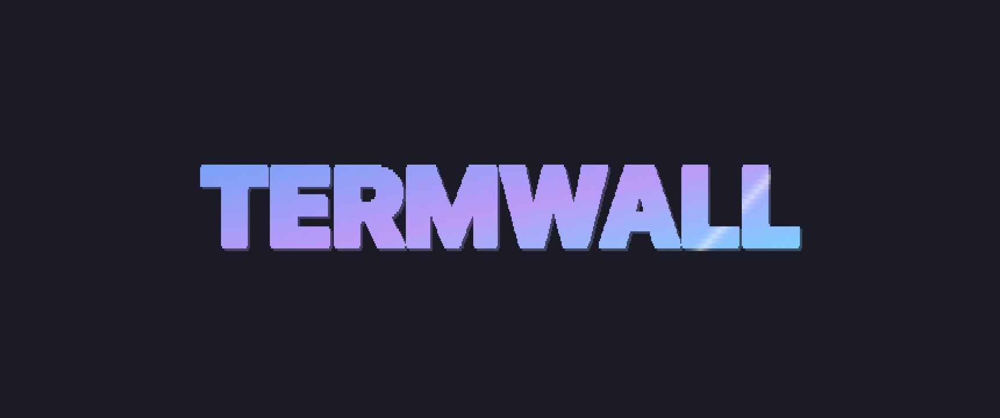
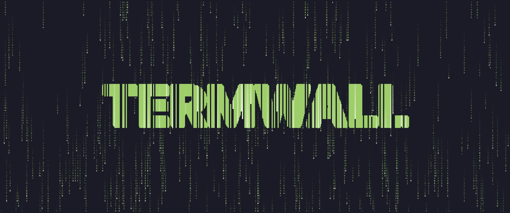
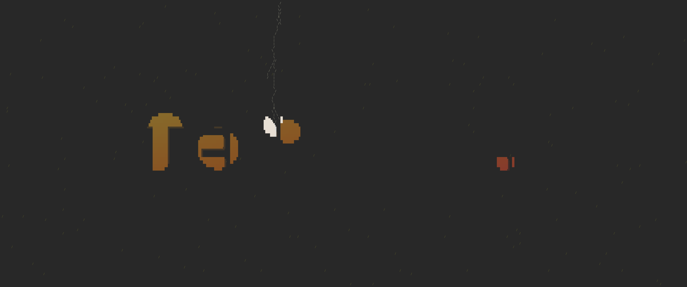
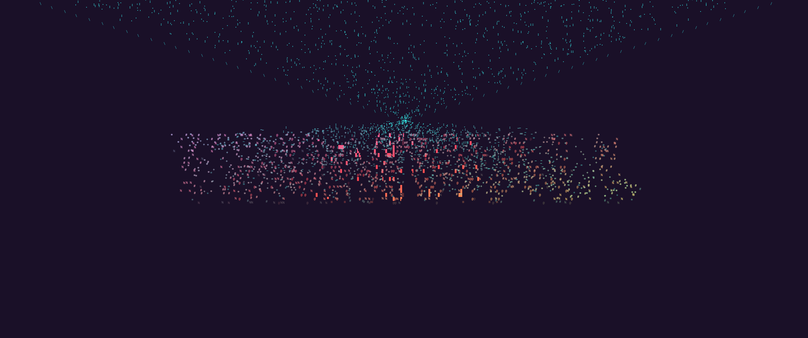
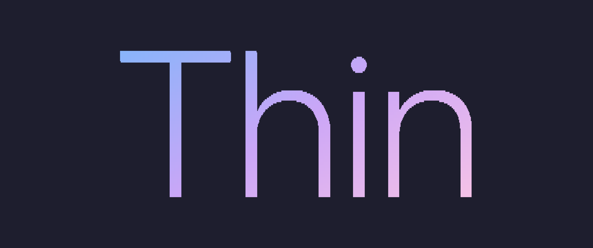
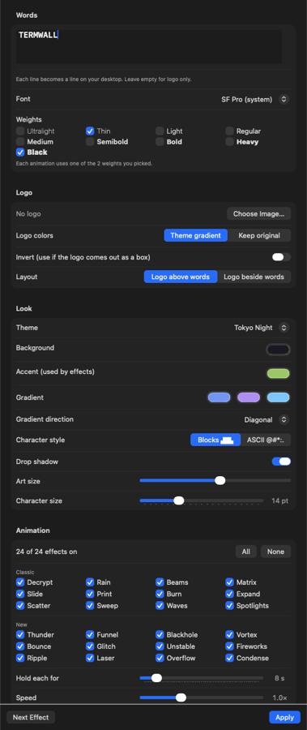

# TermWall

An animated terminal-style wallpaper for macOS. Your words and/or logo are drawn out of block and ASCII characters, played in with one of 24 terminal text effects, held for a few seconds, then played out again. It lives on your desktop, behind your icons, and can be your screen saver too.

Inspired by the look of the Omarchy screen saver.



| | |
|---|---|
|  |  |
|  |  |

## Features

- **Your own art:** any words (several lines), any font, any logo image (PNG, SVG, JPEG, WebP…), or paste your own ASCII art.
- **24 effects:** decrypt, rain, beams, matrix, slide, print, burn, expand, scatter, sweep, waves, spotlights, thunder, funnel, blackhole, vortex, bounce, glitch, unstable, fireworks, ripple, laser, overflow, condense. Plus 7 ways out: dissolve, fall, fade, scatter, funnel, blackhole, shatter. Moving characters are ASCII that gets denser as they travel and turn into blocks when they land.
- **Font weights:** tick any of the nine weights (Ultralight to Black) and each animation uses a different one.
- **Themes:** Tokyo Night, Catppuccin, Gruvbox, Nord, Everforest, Kanagawa, Rosé Pine, Matte Black, Matrix, Synthwave, or your own colors.
- **Changing colors:** optionally give every animation new colors (your colors shifted around the color wheel, or a random theme), with the background fading to match if you like, any of 12 gradient directions and patterns (diagonals, radial, corner, middle-out, conic, diamond, rings, stripes, waves…) or a random one each time, and/or a gradient that flows slowly across your art. Flowing keeps redrawing while the art holds still, so it costs some power (about 9–12% CPU on a large two-screen setup); changing colors each animation costs nothing.
- **Shine:** while your art holds, a light passes over it: a diagonal sweep, a slide in any direction, a thin square, circle or diamond outline growing from the center, or a sparkle. Pick one, Random, or Off.
- **Screen saver too:** the same animation and settings as a macOS screen saver. The desktop animation pauses while the screen saver is showing.
- **Flashing lights setting:** turn the screen flashes, lightning, bursts and glitch flicker down (Soft), off, or anywhere in between. With it off, every effect still plays, just without flashing.
- **Smooth Space switching:** TermWall's window sits just below your desktop icons, where macOS keeps it on screen while Spaces switch (Ctrl ←/→). For the one instant macOS shows only the wallpaper, TermWall sets your macOS wallpaper to a still of its art, so your old wallpaper never flashes. Quitting puts your wallpaper back. You can turn the wallpaper part off in Customize → Look.
- **Multiple screens:** every display gets its own copy, running at that display's refresh rate.
- **Light on power:** drawn on the GPU in one call per frame, only over the part of the screen an effect actually uses, and nothing at all is drawn between animations. Below your screen's refresh rate it wakes only when a frame is due, so macOS redraws the desktop less often. It can pause by itself when a game or window covers the desktop, on battery, or in Low Power Mode, and there are frame-rate, resolution and particle settings (with Max / Balanced / Battery saver presets).

## Install

**Download:** grab `TermWall.zip` from the [latest release](https://github.com/Kyle-15/TermWall/releases/latest), unzip it and move `TermWall.app` to Applications.

The app isn't notarized by Apple, so the first launch is blocked. Either right-click the app → **Open** → **Open**, or run:

```bash
xattr -dr com.apple.quarantine /Applications/TermWall.app
```

**Build it yourself** (needs Xcode or the Command Line Tools):

```bash
git clone https://github.com/Kyle-15/TermWall.git
cd TermWall
./build.sh install
```

That builds `build/TermWall.app`, copies it to `~/Applications` and starts it.

Requires macOS 14 or newer.

## Use

TermWall runs from the menu bar (the TV-with-sparkles icon):

- **Customize…** words, font and weights, logo, theme and colors, effects, timing, and performance. Press **Apply** to see the changes.
- **Next Effect**, **Pause**, **Reload**
- **Install Screen Saver…** copies the TermWall screen saver into `~/Library/Screen Savers` and opens Screen Saver settings. Pick **TermWall** there (usually under Other). It uses the same settings as the desktop.
- **Start at Login** adds a login item so it comes back after a restart.
- **Quit TermWall** gives you your normal wallpaper back.



Settings are saved in `~/Library/Application Support/TermWall/config.json`. Logos you pick are copied into that folder too.

## How it works

`Sources/main.swift` is a small menu-bar app, `Sources/Saver.swift` is the screen saver, and `Sources/Shared.swift` holds the settings code both use. For every screen it opens a borderless window at desktop level (above the real wallpaper, below the icons) that ignores the mouse, and shows `wall.html` in a WebKit view. The page turns your text and logo into a grid of quadrant-block characters and draws every frame with one instanced WebGL2 call from a glyph atlas (with a Canvas 2D fallback). The app watches the window list, battery and Low Power Mode and tells each screen when to pause.

The screen saver runs inside macOS's sandboxed screen saver host, which may read the user's files, so it reads the same `config.json`. On macOS 14 and newer that host doesn't reliably call `startAnimation`/`stopAnimation`, so the screen saver plays as soon as its page loads and stops on the `com.apple.screensaver.willstop` notification. For debugging, build it with `SAVER_FLAGS="-D TERMWALL_DIAG" ./build.sh` and it reports its state to `http://127.0.0.1:8799/log`.

To try effects in a browser, serve the folder (`python3 -m http.server`) and open `wall.html?effect=thunder&text=HELLO&weights=200,900`.

## License

MIT
